# Omarchy Motion Presets (`omarchy-motion-presets`)

> **Unofficial / Community Collection**: A curated library of 19 Hyprland animation preset Lua files with an interactive CLI selector for Omarchy.

A set of handcrafted Hyprland animation configuration presets — each a self-contained Lua file defining bezier curves and animation rules — plus a CLI tool for browsing, previewing, and applying them live.

This project was developed through an AI-assisted workflow. The concept, customization, configuration, testing, integration, and final iteration were directed and carried out by me.

---

## My Contribution

I did not write Omarchy, Quickshell, or Hyprland from scratch. What I contributed:

- **Preset Design**: Authored all 19 animation preset Lua files in `animations/`, each defining distinct bezier easing curves and Hyprland animation rule sets tuned for aesthetic and performance targets on AMD Radeon Vega integrated graphics.
- **CLI Selector**: Designed and implemented the `bin/omarchy-animation-style` CLI tool for listing presets, applying them live via `hyprctl reload`, previewing before committing, and managing the active selection.
- **Performance Optimization**: Tuned each preset for smooth playback on integrated AMD Vega graphics, covering workspace transitions, window open/close, fade, and border animations.
- **Integration**: Wired presets into the Omarchy `looknfeel.lua` include path so they apply seamlessly on `hyprctl reload`.
- **Installer**: Authored `./install.sh` for safe user-scope deployment.
- **Documentation**: Wrote all preset descriptions and usage guides.
- **Testing**: Tested all 19 presets on Omarchy 4.0.2 / Hyprland 0.56.2.

---

## Based On / Credits

- **[Omarchy](https://github.com/basecamp/omarchy)** — The open-source Arch Linux desktop environment by Basecamp. Presets are designed as drop-in complements to Omarchy's `animations.lua` / `looknfeel.lua` configuration system.
- **[Hyprland](https://hyprland.org)** — The Wayland tiling compositor whose animation engine (bezier curves + animation rules) these presets configure. Hyprland itself is not modified.
- **[Quickshell](https://quickshell.outfoxxed.me)** — The Qt6 QML shell used alongside this environment.

**Related Repos**:
- [omarchy-theme-transitions](https://github.com/aarushdalal/omarchy-theme-transitions) — GPU GLSL theme transition shaders
- [omarchy-shell-polish](https://github.com/aarushdalal/omarchy-shell-polish) — Frosted glass, floating bar, keybinding polish
- [omarchy-aesthetic-themes](https://github.com/aarushdalal/omarchy-aesthetic-themes) — 15 anime color themes and live wallpapers

---

## Preset Catalog

| Preset | Description | Showcase |
|---|---|---|
| `bloom.lua` | Gentle organic bloom with soft bounce | [Video](https://raw.githubusercontent.com/aarushdalal/omarchy-motion-presets/main/assets/showcase/bloom.mp4) |
| `comic.lua` | Playful comic-book spring with overshoot | [Video](https://raw.githubusercontent.com/aarushdalal/omarchy-motion-presets/main/assets/showcase/comic.mp4) |
| `cosmic.lua` | Deep-space floaty glide | [Video](https://raw.githubusercontent.com/aarushdalal/omarchy-motion-presets/main/assets/showcase/cosmic.mp4) |
| `cyberpunk.lua` | Sharp neon snap with aggressive deceleration | [Video](https://raw.githubusercontent.com/aarushdalal/omarchy-motion-presets/main/assets/showcase/cyberpunk.mp4) |
| `default.lua` | Balanced Omarchy-style reference baseline | [Video](https://raw.githubusercontent.com/aarushdalal/omarchy-motion-presets/main/assets/showcase/default.mp4) |
| `fluid.lua` | Smooth fluid motion with light inertia | [Video](https://raw.githubusercontent.com/aarushdalal/omarchy-motion-presets/main/assets/showcase/fluid.mp4) |
| `ghost.lua` | Ultra-light near-invisible fade and drift | [Video](https://raw.githubusercontent.com/aarushdalal/omarchy-motion-presets/main/assets/showcase/ghost.mp4) |
| `ignition.lua` | Fast launch burst with afterburn settle | [Video](https://raw.githubusercontent.com/aarushdalal/omarchy-motion-presets/main/assets/showcase/ignition.mp4) |
| `jelly.lua` | Bouncy jelly spring with extended oscillation | [Video](https://raw.githubusercontent.com/aarushdalal/omarchy-motion-presets/main/assets/showcase/jelly.mp4) |
| `liquid.lua` | Heavy liquid pour with slow sink | [Video](https://raw.githubusercontent.com/aarushdalal/omarchy-motion-presets/main/assets/showcase/liquid.mp4) |
| `matrix.lua` | Digital cascade with precise scanline timing | [Video](https://raw.githubusercontent.com/aarushdalal/omarchy-motion-presets/main/assets/showcase/matrix.mp4) |
| `morph.lua` | Organic shape morph with soft warp | [Video](https://raw.githubusercontent.com/aarushdalal/omarchy-motion-presets/main/assets/showcase/morph.mp4) |
| `orbit.lua` | Planetary arc swing with gravitational pull | [Video](https://raw.githubusercontent.com/aarushdalal/omarchy-motion-presets/main/assets/showcase/orbit.mp4) |
| `parallax.lua` | Layered depth parallax with offset curves | [Video](https://raw.githubusercontent.com/aarushdalal/omarchy-motion-presets/main/assets/showcase/parallax.mp4) |
| `quantum.lua` | Ultra-fast quantum blink | [Video](https://raw.githubusercontent.com/aarushdalal/omarchy-motion-presets/main/assets/showcase/quantum.mp4) |
| `snap.lua` | Instant hard snap — minimal animation | [Video](https://raw.githubusercontent.com/aarushdalal/omarchy-motion-presets/main/assets/showcase/snap.mp4) |
| `snappy.lua` | Quick and clean bounce snap | [Video](https://raw.githubusercontent.com/aarushdalal/omarchy-motion-presets/main/assets/showcase/snappy.mp4) |
| `tokyo.lua` | Tokyo drift — signature smooth lateral glide | [Video](https://raw.githubusercontent.com/aarushdalal/omarchy-motion-presets/main/assets/showcase/tokyo.mp4) |
| `unfold.lua` | Origami unfold with sequential reveal | [Video](https://raw.githubusercontent.com/aarushdalal/omarchy-motion-presets/main/assets/showcase/unfold.mp4) |

---

## Showcase Gallery

19 recorded animation presets with animated previews. Click a preview or **Video** to open the full silent MP4 recording.

| Preset | Animated preview |
|---|---|
| `bloom` | [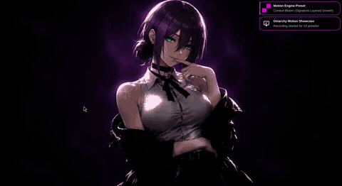](https://raw.githubusercontent.com/aarushdalal/omarchy-motion-presets/main/assets/showcase/bloom.mp4)<br>[Video](https://raw.githubusercontent.com/aarushdalal/omarchy-motion-presets/main/assets/showcase/bloom.mp4) |
| `comic` | [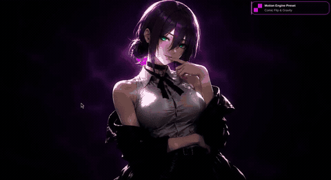](https://raw.githubusercontent.com/aarushdalal/omarchy-motion-presets/main/assets/showcase/comic.mp4)<br>[Video](https://raw.githubusercontent.com/aarushdalal/omarchy-motion-presets/main/assets/showcase/comic.mp4) |
| `cosmic` | [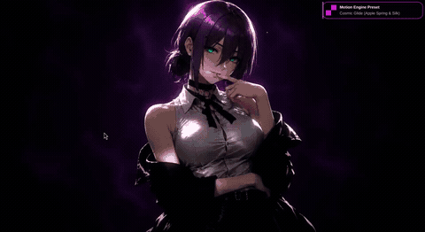](https://raw.githubusercontent.com/aarushdalal/omarchy-motion-presets/main/assets/showcase/cosmic.mp4)<br>[Video](https://raw.githubusercontent.com/aarushdalal/omarchy-motion-presets/main/assets/showcase/cosmic.mp4) |
| `cyberpunk` | [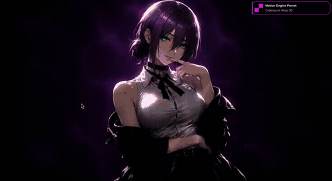](https://raw.githubusercontent.com/aarushdalal/omarchy-motion-presets/main/assets/showcase/cyberpunk.mp4)<br>[Video](https://raw.githubusercontent.com/aarushdalal/omarchy-motion-presets/main/assets/showcase/cyberpunk.mp4) |
| `default` | [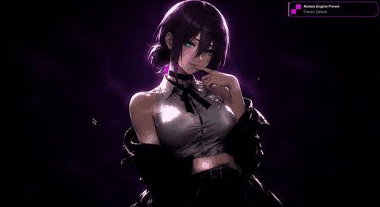](https://raw.githubusercontent.com/aarushdalal/omarchy-motion-presets/main/assets/showcase/default.mp4)<br>[Video](https://raw.githubusercontent.com/aarushdalal/omarchy-motion-presets/main/assets/showcase/default.mp4) |
| `fluid` | [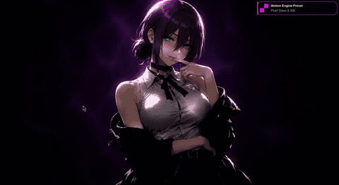](https://raw.githubusercontent.com/aarushdalal/omarchy-motion-presets/main/assets/showcase/fluid.mp4)<br>[Video](https://raw.githubusercontent.com/aarushdalal/omarchy-motion-presets/main/assets/showcase/fluid.mp4) |
| `ghost` | [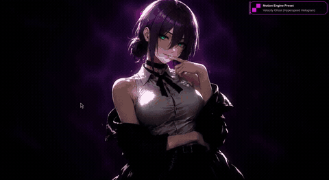](https://raw.githubusercontent.com/aarushdalal/omarchy-motion-presets/main/assets/showcase/ghost.mp4)<br>[Video](https://raw.githubusercontent.com/aarushdalal/omarchy-motion-presets/main/assets/showcase/ghost.mp4) |
| `ignition` | [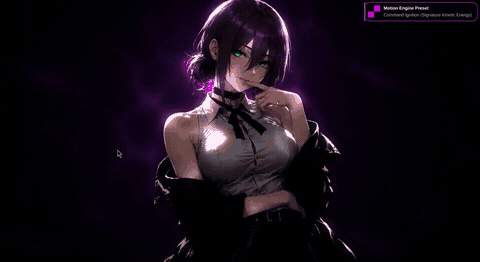](https://raw.githubusercontent.com/aarushdalal/omarchy-motion-presets/main/assets/showcase/ignition.mp4)<br>[Video](https://raw.githubusercontent.com/aarushdalal/omarchy-motion-presets/main/assets/showcase/ignition.mp4) |
| `jelly` | [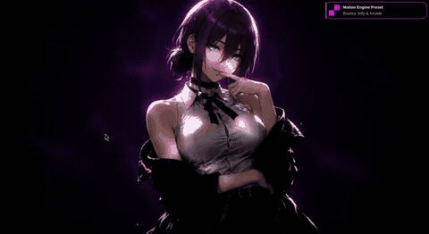](https://raw.githubusercontent.com/aarushdalal/omarchy-motion-presets/main/assets/showcase/jelly.mp4)<br>[Video](https://raw.githubusercontent.com/aarushdalal/omarchy-motion-presets/main/assets/showcase/jelly.mp4) |
| `liquid` | [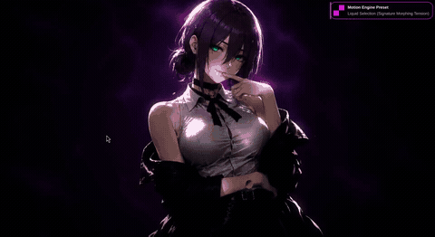](https://raw.githubusercontent.com/aarushdalal/omarchy-motion-presets/main/assets/showcase/liquid.mp4)<br>[Video](https://raw.githubusercontent.com/aarushdalal/omarchy-motion-presets/main/assets/showcase/liquid.mp4) |
| `matrix` | [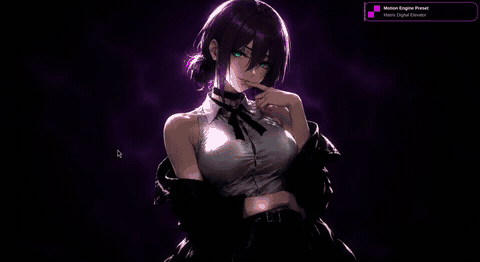](https://raw.githubusercontent.com/aarushdalal/omarchy-motion-presets/main/assets/showcase/matrix.mp4)<br>[Video](https://raw.githubusercontent.com/aarushdalal/omarchy-motion-presets/main/assets/showcase/matrix.mp4) |
| `morph` | [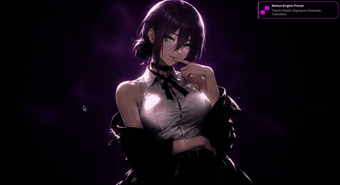](https://raw.githubusercontent.com/aarushdalal/omarchy-motion-presets/main/assets/showcase/morph.mp4)<br>[Video](https://raw.githubusercontent.com/aarushdalal/omarchy-motion-presets/main/assets/showcase/morph.mp4) |
| `orbit` | [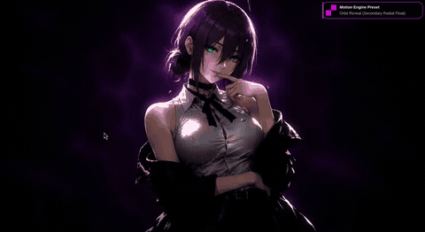](https://raw.githubusercontent.com/aarushdalal/omarchy-motion-presets/main/assets/showcase/orbit.mp4)<br>[Video](https://raw.githubusercontent.com/aarushdalal/omarchy-motion-presets/main/assets/showcase/orbit.mp4) |
| `parallax` | [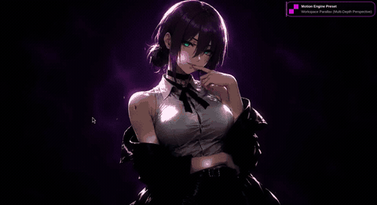](https://raw.githubusercontent.com/aarushdalal/omarchy-motion-presets/main/assets/showcase/parallax.mp4)<br>[Video](https://raw.githubusercontent.com/aarushdalal/omarchy-motion-presets/main/assets/showcase/parallax.mp4) |
| `quantum` | [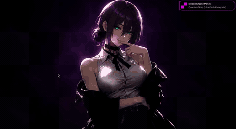](https://raw.githubusercontent.com/aarushdalal/omarchy-motion-presets/main/assets/showcase/quantum.mp4)<br>[Video](https://raw.githubusercontent.com/aarushdalal/omarchy-motion-presets/main/assets/showcase/quantum.mp4) |
| `snap` | [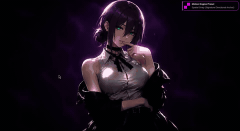](https://raw.githubusercontent.com/aarushdalal/omarchy-motion-presets/main/assets/showcase/snap.mp4)<br>[Video](https://raw.githubusercontent.com/aarushdalal/omarchy-motion-presets/main/assets/showcase/snap.mp4) |
| `snappy` | [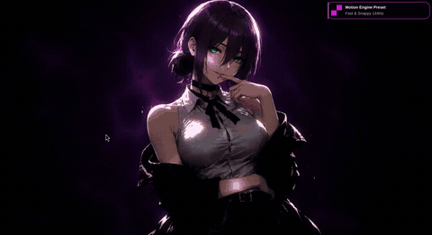](https://raw.githubusercontent.com/aarushdalal/omarchy-motion-presets/main/assets/showcase/snappy.mp4)<br>[Video](https://raw.githubusercontent.com/aarushdalal/omarchy-motion-presets/main/assets/showcase/snappy.mp4) |
| `tokyo` | [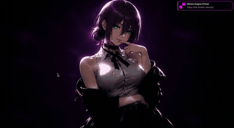](https://raw.githubusercontent.com/aarushdalal/omarchy-motion-presets/main/assets/showcase/tokyo.mp4)<br>[Video](https://raw.githubusercontent.com/aarushdalal/omarchy-motion-presets/main/assets/showcase/tokyo.mp4) |
| `unfold` | [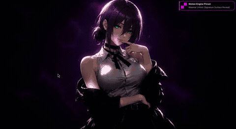](https://raw.githubusercontent.com/aarushdalal/omarchy-motion-presets/main/assets/showcase/unfold.mp4)<br>[Video](https://raw.githubusercontent.com/aarushdalal/omarchy-motion-presets/main/assets/showcase/unfold.mp4) |

Recordings are historical demonstrations of the project. The desktop status bar is cropped from the motion recordings. Audio and source metadata are removed. See [showcase details](docs/SHOWCASE.md).

---

## Repository Structure

```
omarchy-motion-presets/
├── animations/              # 19 Lua preset files
│   ├── tokyo.lua
│   ├── cosmic.lua
│   ├── bloom.lua
│   └── ... (19 total)
├── bin/
│   └── omarchy-animation-style   # CLI selector tool
├── assets/showcase/
├── docs/
└── install.sh
```

---

## Requirements

- **Omarchy** `dev (13f18b2c) / 4.0.2`
- **Hyprland** `0.56.2`
- **Quickshell** `0.3.1` (for shell integration)
- **Bash** ≥ 5.0

---

## Installation

```bash
git clone https://github.com/aarushdalal/omarchy-motion-presets.git
cd omarchy-motion-presets

./install.sh check
./install.sh install --dry-run
./install.sh install
```

---

## Commands

```bash
omarchy-animation-style list               # List all 19 available presets
omarchy-animation-style get                # Show currently active preset
omarchy-animation-style set tokyo          # Apply the 'tokyo' preset and reload Hyprland
omarchy-animation-style preview cosmic     # Preview a preset temporarily
omarchy-animation-style reduced-motion get # Check reduced-motion accessibility setting
omarchy-animation-style reduced-motion set false  # Re-enable animations
```

---

## Troubleshooting

- **Animations look disabled**: Check if reduced motion is enabled:
  ```bash
  omarchy-animation-style reduced-motion get
  ```
  If it returns `true`, toggle it off with `omarchy-animation-style reduced-motion set false`.
- **Validation errors on reload**: Check `hyprctl reload` output in terminal.

---

## Contributing

Suggestions for new physics curves are welcome!

---

## License

[MIT License](LICENSE).

## Refinement and privacy update

19 presets · three intensities · reduced motion. The showcase gallery includes reviewed recordings; see [release privacy](docs/RELEASE-PRIVACY.md). Existing Git history is preserved.
